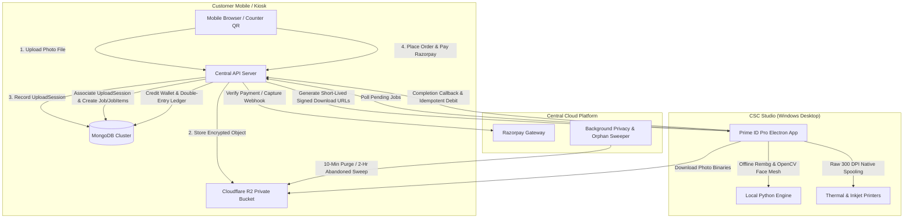

# Architectural Deep Dive — Prime ID Pro

---

## 1. System Topology & Data Flow



---

## 2. Storage & Privacy Abstraction

```
StorageService
   ├── LocalStorageDriver (Development & Unit Testing)
   └── R2StorageDriver (Cloudflare R2 Private Object Storage)
```

- **Private Bucket**: The Cloudflare R2 bucket has public access permanently disabled.
- **Server-Generated Keys**: Every photo key is generated server-side with non-sequential, random cryptographic IDs: `temp-photos/YYYY/MM/DD/center_<centerId>/<random16Hex>.jpg`.
- **Signed Download URLs**: Central API issues short-lived presigned URLs (TTL: 15–30 minutes) to authorized devices and users.
- **Upload Sessions**: Unclaimed uploads are tracked in `UploadSession` records and swept automatically after 2 hours if no order is created.
- **Completed Job Purge**: After print completion, photos are retained for 10 minutes, then physically deleted from R2 and marked purged in database records.

---

## 3. Multi-Photo Batch Processing Model

Each print order submitted by a customer is represented as:
- **1 `Order`**: Contains financial quote, frozen pricing snapshots, payment method, customer contact details, and platform fee.
- **1 `Job`**: Coordinates desktop state machine (`QUEUED` → `ACKNOWLEDGED` → `DOWNLOADING` → `PROCESSING` → `PRINTING` → `COMPLETED`).
- **N `JobItems`**: Sub-photos representing individual images in the batch, each maintaining its own storage key, crop parameters, and copy counts.

---

## 4. Atomic State Transitions & Concurrency Guards

```
[CUSTOMER SUBMISSION] 
       │
       ▼
 [CREATED] ──(Online Payment Captured or Operator Marks Cash Received)──► [QUEUED]
                                                                              │
                                                     (Atomic Device Ack Claim)▼
                                                                        [ACKNOWLEDGED]
                                                                              │
                                                                              ▼
                                                                        [DOWNLOADING]
                                                                              │
                                                                              ▼
                                                                        [PROCESSING]
                                                                              │
                                                                              ▼
                                                                         [PRINTING]
                                                                              │
                                                          (Device Complete)   ▼
                                                                        [COMPLETED]
                                                                              │
                                                           (10-Minute Retention Timer)
                                                                              ▼
                                                                      [PHOTO PURGED]
```
